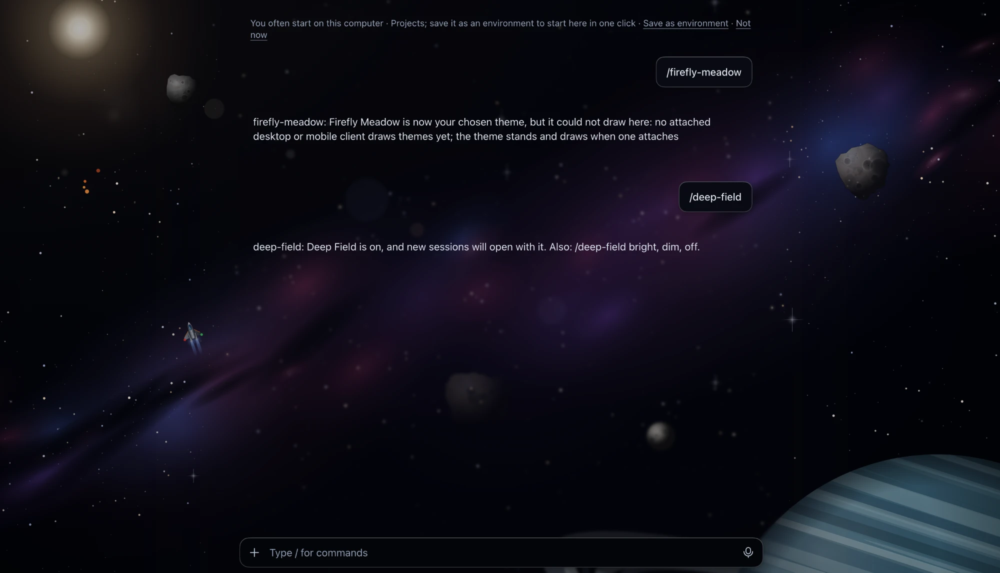
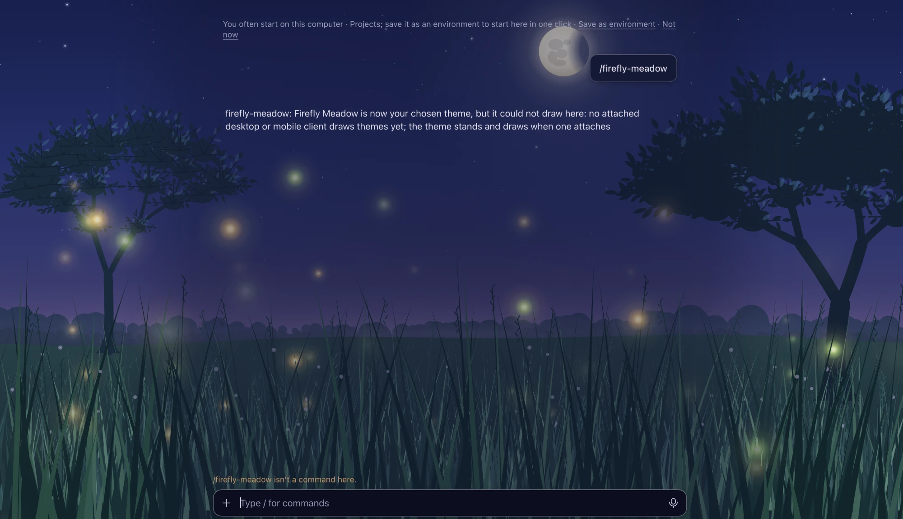

# Claude themes

Animated background themes for the Claude desktop app (Code tab). They also draw in the
mobile app. The terminal doesn't draw themes.

| Theme | What it looks like |
| --- | --- |
| [Deep Field](deep-field/) | A self-playing asteroid game behind the window, with a nebula, a ringed planet and shooting stars. Dark frosted panels, cyan and orange accents. |
| [Firefly Meadow](firefly-meadow/) | A summer night in tall swaying grass, with about 55 fireflies, twinkling stars, a moon and the odd shooting star. Indigo panels, firefly-amber accents. |

### Deep Field



### Firefly Meadow



## Install

Add this marketplace once:

```bash
claude plugin marketplace add amandamartin-dev/claude-mods
```

Then install the themes you want:

```bash
claude plugin install deep-field@my-mods
```

```bash
claude plugin install firefly-meadow@my-mods
```

Start a new session, or run the theme's slash command (`/deep-field` or `/firefly-meadow`)
to switch to it now.

## Switching themes

You can keep both enabled. The one you picked last is stored in `~/.claude/active-theme`,
and new sessions open with it.

- `/deep-field` or `/firefly-meadow` switches to that theme.
- `/deep-field off` or `/firefly-meadow off` goes back to the app's own look.
- Deep Field also has `/deep-field bright` and `/deep-field dim`.

Each theme's own README covers tuning and how it's built.

## A note on trust

Themes are plugins, so installing one runs its hook code (`hooks/register.tsx`) in your
Claude session. All the source is in this repo, so you can read it first.

## License

MIT, see [LICENSE](LICENSE). `hooks/make-colors.js` in each theme is a generated helper
from Claude's mod tooling. It isn't covered by this license.
